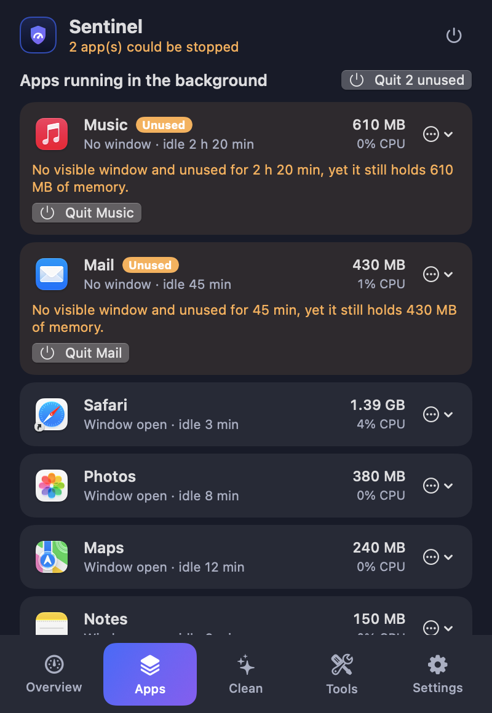
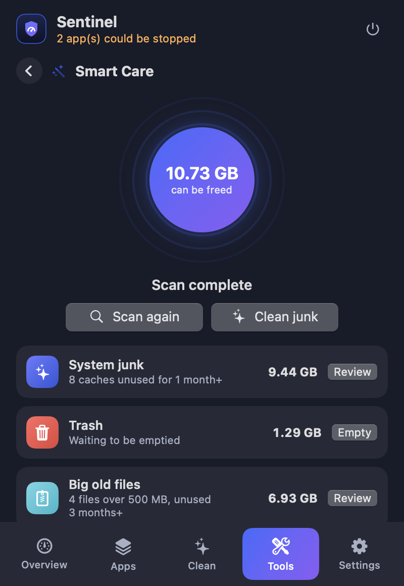
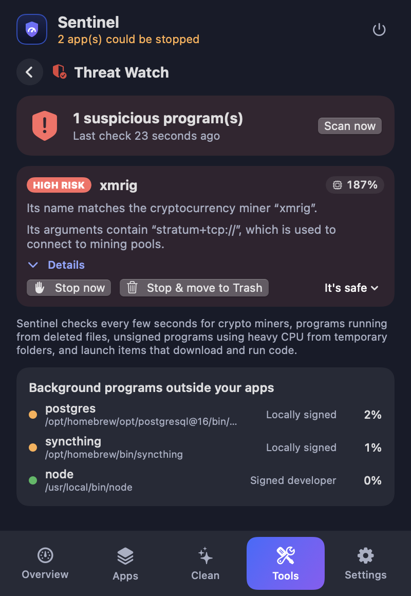
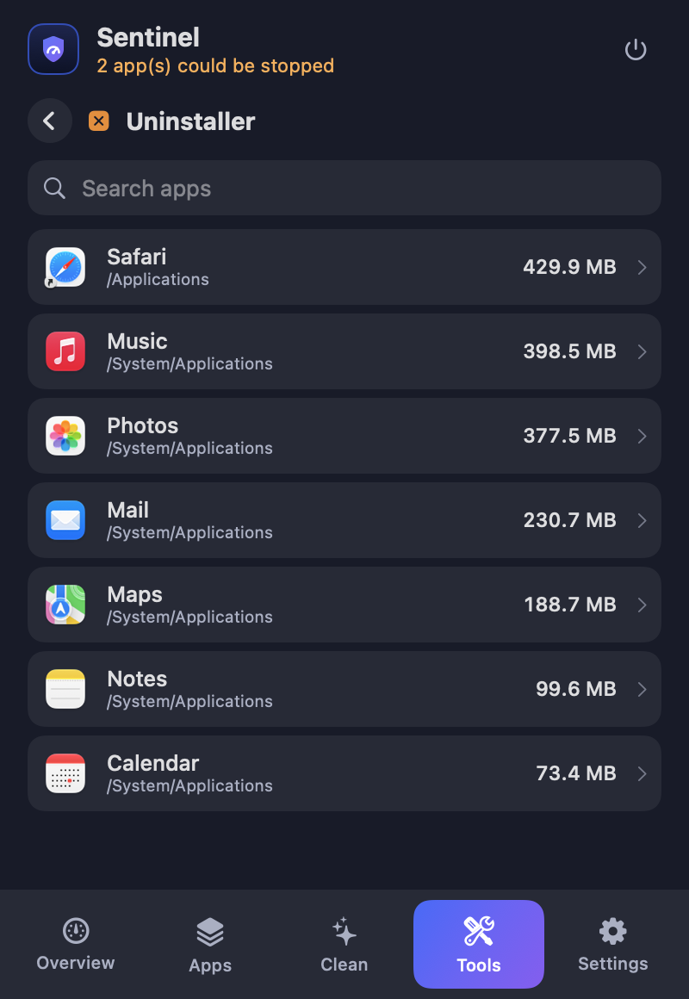
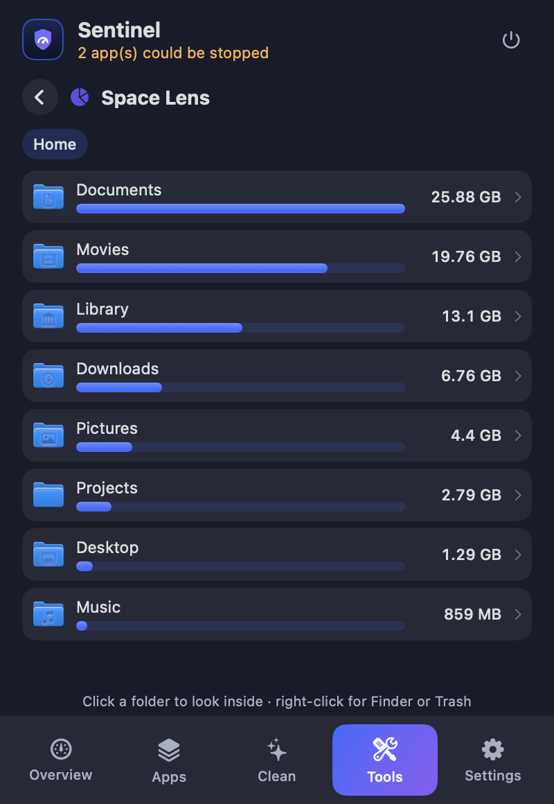
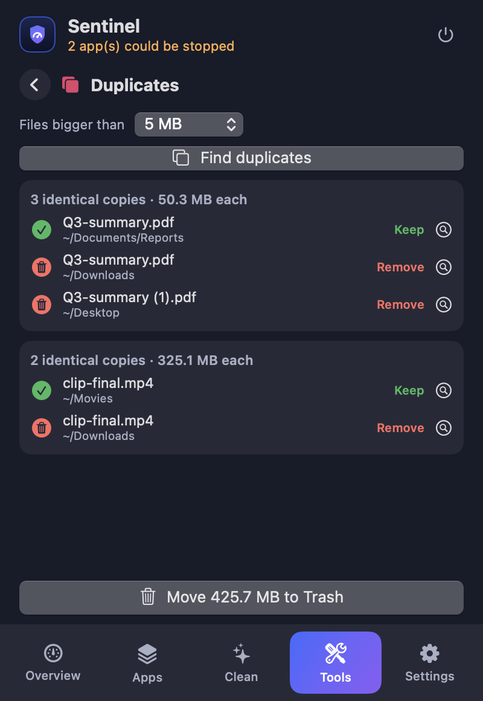
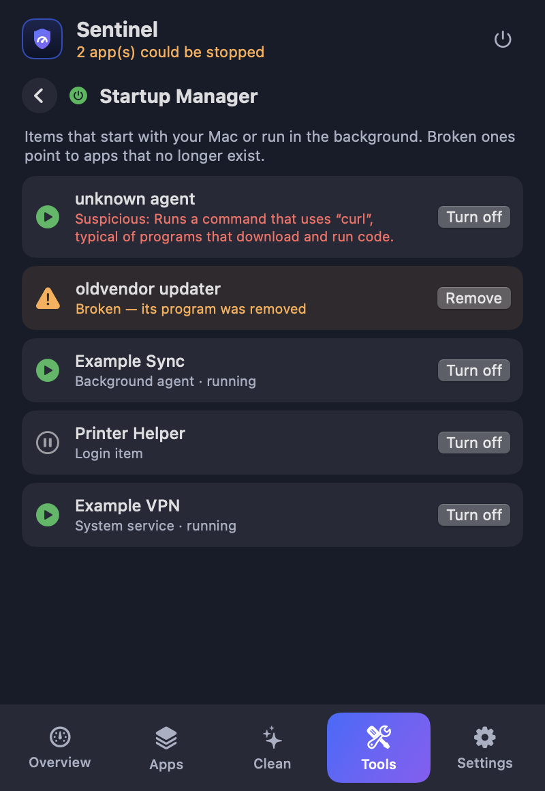
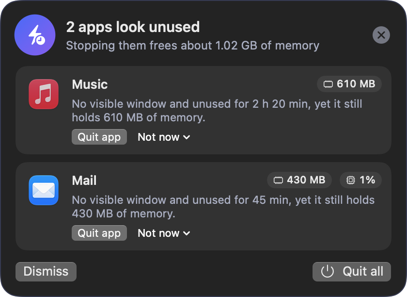
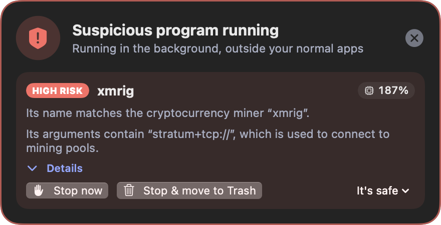

<div align="center">


# Sentinel

**A native macOS menu-bar app that keeps your Mac fast, clean and safe.**
It watches memory, battery and disk, finds apps you are not using, cleans old caches, removes apps with all their data, and warns you about hidden background programs such as crypto miners.

[](#requirements)
[](#requirements)
[](LICENSE)
[](https://github.com/alfayedoficial/sentinel-mac/actions/workflows/ci.yml)

[Website](https://alfayedoficial.github.io/sentinel-mac/) · [Download](https://github.com/alfayedoficial/sentinel-mac/releases/latest) · [Features](docs/FEATURES.md) · [Architecture](docs/ARCHITECTURE.md) · [Development guide](docs/DEVELOPMENT.md) · [Roadmap](ROADMAP.md)

 &nbsp; 

</div>

---

## Why Sentinel?

Cleaning tools are often closed, paid and hard to trust. Sentinel is the opposite: **open source, free, and it never deletes anything without showing you first.**

- Everything it removes goes to the **Trash**, and a built-in **History** lets you restore it.
- It makes **no network connections** of its own and sends no data anywhere.
- It runs lightly: all scanning happens on a background thread, so the menu never lags.

## Features

| | |
|---|---|
| **Live monitor** | Memory pressure, battery and disk rings, plus the top memory users. |
| **Idle app detection** | Finds background apps with no window that still hold memory or burn CPU, shows *why*, and lets you quit them. A popup appears so you do not have to open the app. |
| **Cache cleaner** | Finds caches and logs not touched for 1 week, 1 month, 3 months, 6 months or 1 year. You review a report before anything moves. |
| **Smart Care** | One scan for caches, Trash, big old files, startup items and idle apps, with a one-tap clean of the safe parts. |
| **Uninstaller** | Removes an app together with its caches, preferences, containers and saved state. |
| **Big old files** | Finds large files you have not touched for a long time. |
| **Duplicate finder** | Compares real file contents (SHA-256), keeps one copy and moves the rest to the Trash. |
| **Space Lens** | Drill into folders to see exactly what fills your disk. |
| **Startup Manager** | Lists login items, background agents and services. Flags broken leftovers and suspicious ones. |
| **Threat Watch** | Detects crypto miners and hidden background programs and lets you stop them in one click. |
| **Maintenance** | Restart Dock or Finder, fix the "Open With" menu, reset Quick Look, clear font cache, flush DNS. |
| **History & Restore** | A log of everything Sentinel moved to the Trash, with one-click restore. |
| **Weekly reminder** | Optional notification when more than 200 MB of old caches have built up. |

See [docs/FEATURES.md](docs/FEATURES.md) for how each feature decides what to show.

## Screenshots

All screenshots use **sample data**, generated by the app itself (see [Regenerating screenshots](docs/DEVELOPMENT.md#regenerating-the-screenshots)).

| Idle apps | Clean caches | Tools |
|---|---|---|
|  |  |  |

| Smart Care | Threat Watch | Uninstaller |
|---|---|---|
|  |  |  |

| Space Lens | Duplicates | Startup Manager |
|---|---|---|
|  |  |  |

| Popup: unused apps | Popup: threat |
|---|---|
|  |  |

More images are in [`docs/images`](docs/images). The visual design is described in [docs/DESIGN.md](docs/DESIGN.md).

## Requirements

- macOS 14 (Sonoma) or newer, Apple Silicon or Intel
- Xcode 15 or newer (or the Swift 5.9+ toolchain) to build from source

## Install

### Option 1: Download (no Xcode, no clone)

1. Download **[Sentinel.zip](https://github.com/alfayedoficial/sentinel-mac/releases/latest/download/Sentinel.zip)** (universal: Apple Silicon and Intel, about 2.5 MB). Older versions and the SHA-256 checksum are on the [releases page](https://github.com/alfayedoficial/sentinel-mac/releases).
2. Unzip it and drag **Sentinel.app** into your **Applications** folder.
3. **First open only:** macOS says it cannot check the app, because it is signed locally and not notarized. Right-click the app → **Open** → **Open**, or run:
   ```bash
   xattr -dr com.apple.quarantine /Applications/Sentinel.app
   ```

### Option 2: Build from source

You know exactly what runs on your Mac.

```bash
git clone https://github.com/alfayedoficial/sentinel-mac.git
cd sentinel-mac
./build.sh
open ~/Applications/Sentinel.app
```

No git? [Download the source as a zip](https://github.com/alfayedoficial/sentinel-mac/archive/refs/heads/main.zip), unzip it and run `./build.sh` in the folder. `build.sh` builds the app and its helper, signs them locally and installs **`~/Applications/Sentinel.app`**.

Either way, a small icon with your memory percentage appears in the menu bar. Click it to open Sentinel.

### First-run permissions

Sentinel asks for the least it needs, and each permission is requested once:

| Permission | Why | When |
|---|---|---|
| **Background helper** (System Settings → Login Items & Extensions) | Lets Sentinel switch off third-party system launch items without asking for your password every time. It can only touch `/Library/LaunchAgents` and `/Library/LaunchDaemons`, never Apple items. | Once, optional |
| **Automation → Finder** | Moves apps that macOS protects to the Trash. | First uninstall |
| **Automation → System Events** | Reads and removes login items. | First Startup scan |
| **Notifications** | Weekly reminder only. | If you enable it |

Details and the security model are in [SECURITY.md](SECURITY.md).

To start Sentinel with your Mac, tick **Open Sentinel at login** in its Settings tab.

## Usage in 30 seconds

1. Click the menu-bar icon.
2. Press **Scan** on the Smart Care banner to see everything at once, or open a tool from the **Tools** tab.
3. Review the list. Nothing is changed until you confirm.
4. Changed your mind? **Tools → History → Restore**.

## Develop

```bash
swift build          # debug build
swift test           # 69 unit tests
./build.sh           # build, sign and install the app
```

The [development guide](docs/DEVELOPMENT.md) explains the code layout, how to add a new tool or detection rule, and how to open a pull request. Ideas for what to build next are in the [roadmap](ROADMAP.md) and the [issues](https://github.com/alfayedoficial/sentinel-mac/issues?q=is%3Aissue+label%3Aenhancement).

## Project layout

```
Sources/
  Sentinel/          the app (SwiftUI): monitor, cleaners, tools, UI, threat watch
  SentinelHelper/    tiny root helper that switches off third-party launch items
  SentinelCommon/    code shared by both, including the helper's safety rules
Tests/SentinelTests/ unit tests
LaunchDaemons/       launchd plist for the helper
Assets/              app icon sources
docs/                documentation, screenshots and the project website
```

## Privacy

- No network connections, accounts, analytics or telemetry.
- Everything it learns about your Mac stays on your Mac.
- The only data it stores is its History list (`~/Library/Application Support/Sentinel/history.json`) and your settings.

## Limits (please read)

- Sentinel is a **lookout, not an antivirus**. Threat Watch catches known miner names, mining-pool arguments, deleted executables, unsigned heavy programs in temporary folders and suspicious launch items. A new, well-hidden threat can still slip through.
- It cannot see other users' processes and it does not block network traffic.
- The app is signed **locally**, not with a paid Apple Developer certificate, so it is not notarized. That is fine for personal use; see the [roadmap](ROADMAP.md) for signed releases.

## Contributing

Contributions are welcome, from typo fixes to new tools. Please read [CONTRIBUTING.md](CONTRIBUTING.md) first. Be kind: see the [Code of Conduct](CODE_OF_CONDUCT.md).

If Sentinel helps you, a ⭐ on the repository helps others find it.

## License

[MIT](LICENSE) © 2026 Ali Al-Shahat Ali. You may use, change and share it freely, including commercially, as long as the license notice is kept.

---

<div align="center">Made by <a href="https://afapps.4fdev.com">AF.APPS</a></div>
