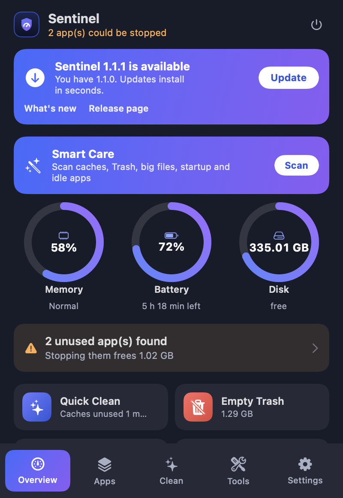
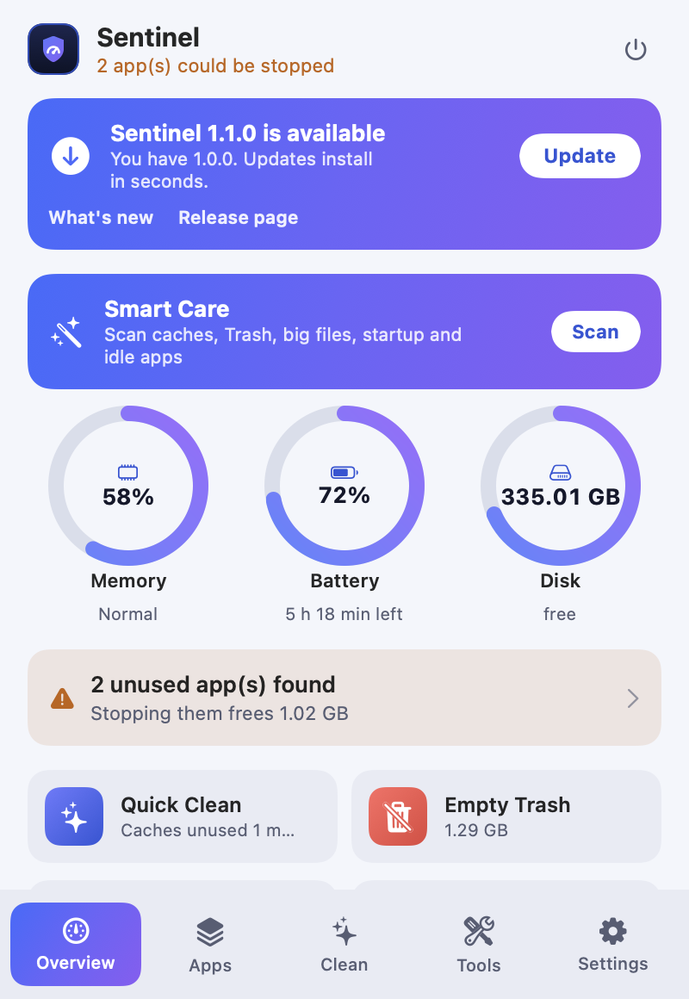
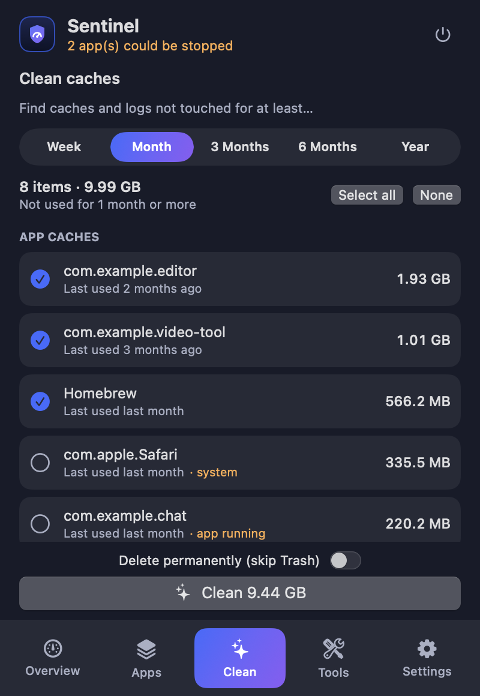
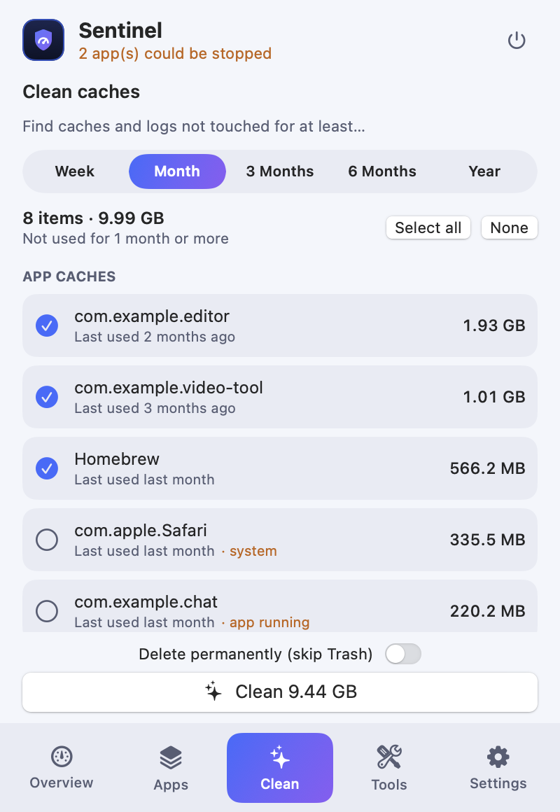
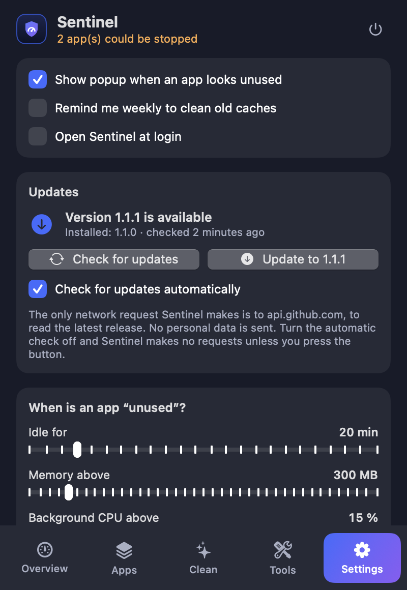
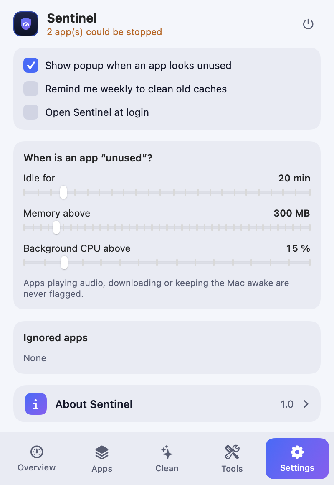
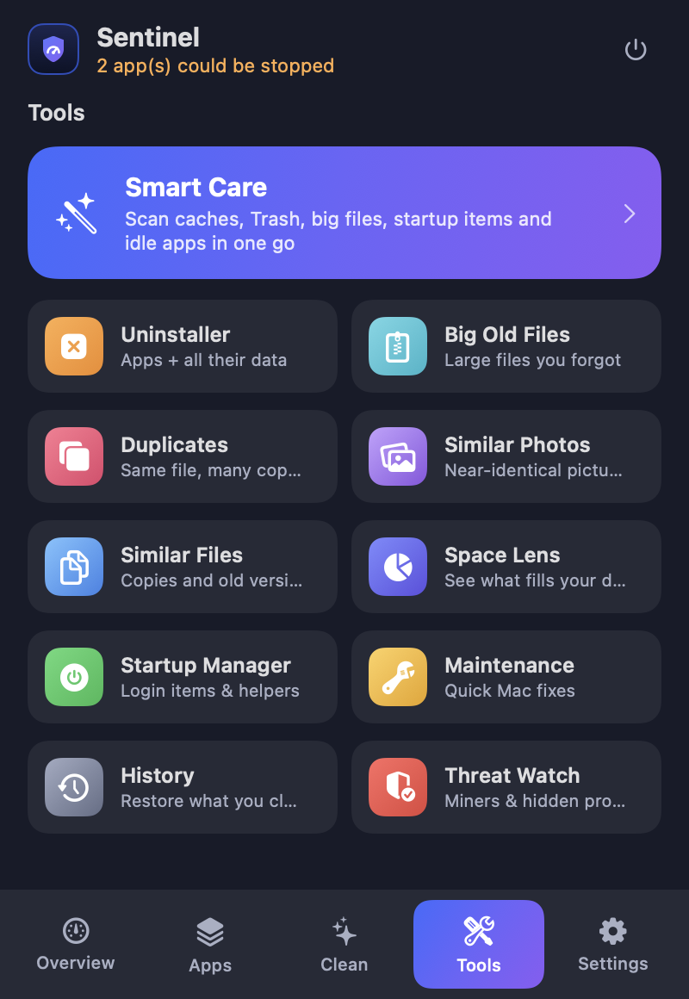
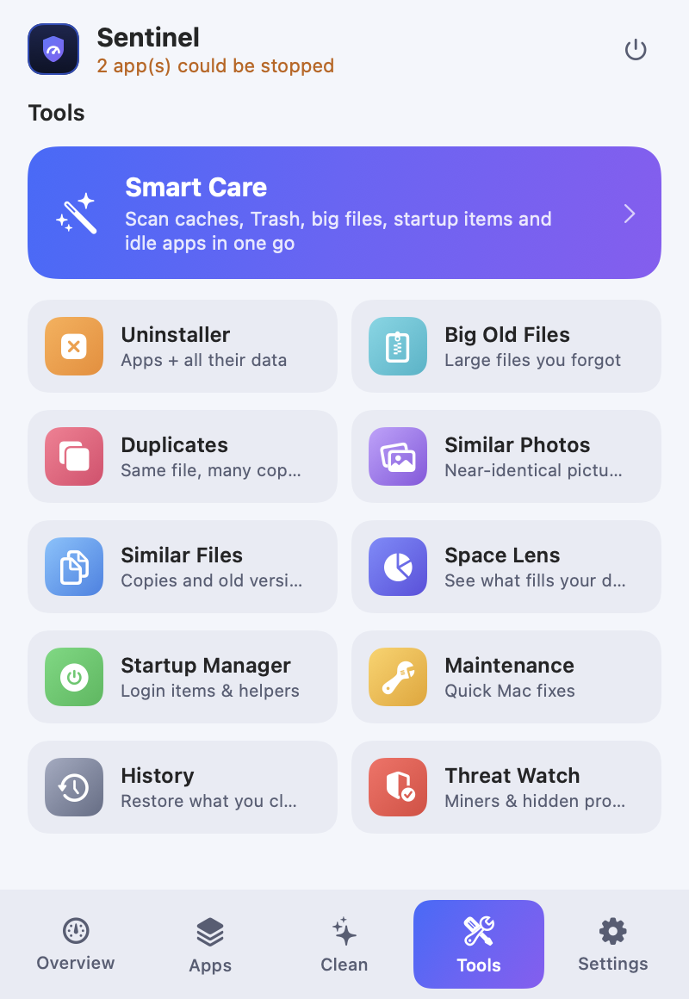

# Design

Sentinel looks the same in the app, the screenshots and the website. All values below live in `Sources/Sentinel/Theme.swift`, the single source of truth.

## Principles

1. **Calm and clear.** One primary action per screen, details on demand.
2. **Safe by default.** Anything destructive shows a list first, then a confirmation that says what, how much, and that it goes to the Trash.
3. **Fast.** Short springs (150–350 ms), no animation on large lists, nothing animates while the window is closed.
4. **Native.** SF Pro, SF Symbols, system materials, follows light and dark appearance.

## Color

Dynamic colors switch with the system appearance.

### Brand

| Token | Hex | Use |
|---|---|---|
| `accent` | `#3F6BFF` | Primary blue, bars, links on tiles |
| `accentDeep` | `#2F55D8` | Solid buttons |
| `violet` | `#8B5CF6` | Gradient end |
| `brand` gradient | `#3F6BFF → #8B5CF6` (135°) | Smart Care banner, selected tab, logo accents |
| `ring` gradient | `#5B86FF → #9B6CFF` | Progress rings |

### Surfaces and text

| Token | Dark | Light |
|---|---|---|
| `win` (window) | `#171B29` | `#F4F6FB` |
| `card` | white 6.5 % | `#1E3278` 5.5 % |
| `tabbar` | white 5 % | `#1E3278` 5 % |
| `track` | white 12 % | `#1E3278` 12 % |
| `edge` | `#788CFF` 22 % | `#283C8C` 16 % |
| `t1` (text) | `#FFFFFF` | `#14182B` |
| `t2` (secondary text) | `#A9AFC4` | `#575D74` |
| `link` | `#8FA6FF` | `#2F55D8` |

### Status

| Token | Dark | Light |
|---|---|---|
| `success` | `#3FB95F` | `#248A3D` |
| `warning` | `#FFAE4D` | `#C2620A` |
| `danger` | `#FF6B63` | `#C62F28` |

### Tool tiles

Each tool has a gradient tile so it is recognizable at a glance.

| Tool | Gradient |
|---|---|
| Clean | `#6C7BFF → #2F55D8` |
| Trash | `#FF6B63 → #E0453D` |
| Uninstaller | `#FFAE4D → #F08A24` |
| Startup | `#5EDB7A → #34B955` |
| Big files | `#6FD8E6 → #2FB5C9` |
| Duplicates | `#FF7A93 → #E0456B` |
| Space Lens | `#7D8BFF → #5C4FE0` |
| Maintenance | `#FFD25E → #E8A317` |
| History | `#A3ABC2 → #646D86` |

## Layout

- Window: **400 × 580** pt, 16 pt side gutter.
- Cards: radius 12, panels 14, popups 20.
- Tab bar with five tabs: Overview, Apps, Clean, Tools, Settings. The selected tab is a brand-gradient pill that slides between tabs.
- Type: system font; titles 15 pt bold, body 12–13 pt, captions 10–11 pt; numbers use monospaced digits.

## Motion

| Where | Motion |
|---|---|
| Rings and bars | 0.8–1 s spring on appear, 0.6–0.8 s on change |
| Tab pill | matched-geometry spring (0.38 s) |
| Tool screens | slide in from the trailing edge |
| Confirm card | scale + fade (0.35 s) |
| Popups | slide in 0.4–0.45 s, fade out 0.25 s |

## Logo

A shield with a gauge needle inside: protection plus monitoring. The mark is drawn in code (`ShieldShape`, `GaugeShape`, `SentinelMark`), so it is crisp at every size. The app icon is a dark rounded square with the mark and a small row of status dots. Sources are in [`Assets`](../Assets).

## Screens

| Dark | Light |
|---|---|
|  |  |
|  |  |
|  |  |
|  |  |

More: `apps`, `smart-care`, `uninstaller`, `big-files`, `duplicates`, `space-lens`, `startup`, `maintenance`, `history`, `threat-watch`, `popup-unused-apps`, `popup-threat` in [`docs/images`](images).

## Accessibility

Work in progress. Today Sentinel uses native controls, supports light and dark appearance and aims for readable contrast. Missing and welcome as contributions: accessibility labels on every icon-only button, Reduce Motion support, and complete keyboard navigation. They are tracked in the [roadmap](../ROADMAP.md).
